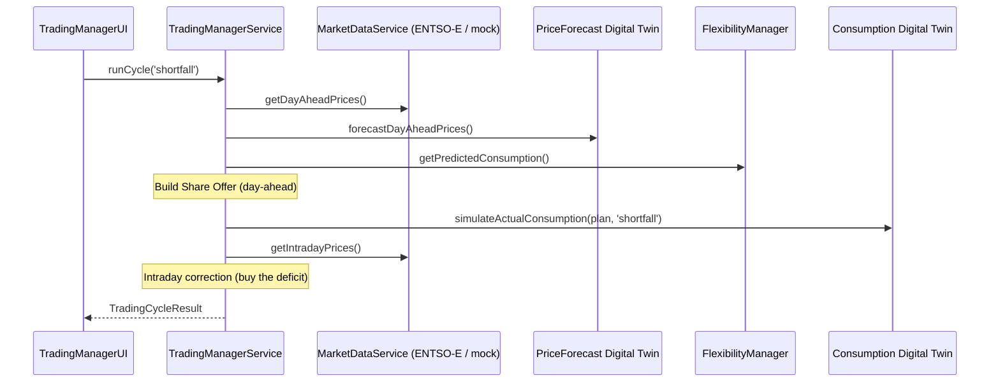

# "Simulate day-ahead shortfall" — Detailed flow

This document describes, step by step, everything the application does when the user clicks the **"Simulate day-ahead shortfall"** button inside the _Trading Manager & Flexibility Manager_ panel.

The **shortfall** scenario means that, once the delivery day arrives, **more** energy was consumed than was bought on the day-ahead market, so the deficit must be **bought** on the intraday market.

---

## 1. High-level summary



The cycle emits **13 sequential events** (with artificial delays to simulate network latency). Each event advances the flow diagram (`TradingFlowDiagram`) and appends an entry to the event log (`EventTimeline`).

---

## 2. Event trigger in the UI

File: [src/components/TradingManagerUI.tsx](../src/components/TradingManagerUI.tsx)

The button is wired to `runScenario('shortfall')`:

```tsx
<button onClick={() => runScenario('shortfall')} disabled={isRunning}>
  <TrendingUp size={18} />
  Simulate day-ahead shortfall
</button>
```

`runScenario` does the following (`useCallback`):

1. `setIsRunning(true)` → disables both buttons (`disabled={isRunning}`) and starts the diagram animation.
2. Resets the previous state: `setEvents([])`, `setCurrentStage(null)`, `setResult(null)`.
3. Registers the event callback with `tradingManagerService.onFlowEvent(...)`, which for every event:
   - `setCurrentStage(event.stage)` → highlights the active stage in the diagram.
   - `setEvents(prev => [...prev, event])` → appends the line to the timeline.
4. Calls `await tradingManagerService.runCycle('shortfall')` and stores the result with `setResult(cycleResult)`.
5. In the `finally` block, `setIsRunning(false)` → re-enables the buttons and stops the animation.

> Note: when the animation stops, `TradingFlowDiagram` clears `completedStages` (see the `useEffect` on `isAnimating`).

---

## 3. Orchestration: `TradingManagerService.runCycle('shortfall')`

File: [src/services/TradingManagerService.ts](../src/services/TradingManagerService.ts)

Each step calls `this.emit(stage, message)` (which builds a `TradingFlowEvent` with `status: 'success'` and sends it to the callback) and then awaits a `this.delay(ms)`.

### Day-ahead phase (steps 1–9)

| # | Event (`stage`) | Message / action | Delay |
|---|------------------|------------------|---------|
| 1 | `market-service-ask-external` | "Market Service ASKs the external market (ENTSO-E) for day-ahead prices" | 400 ms |
| — | _(computation)_ | `marketPrices = await marketDataService.getDayAheadPrices()` | — |
| 2 | `market-service-post-prices` | "Market Service POSTs day-ahead prices to the Knowledge Engine" | 400 ms |
| 3a | `trading-manager-react-prices` | "Trading Manager REACTs to the day-ahead prices" | 300 ms |
| 3b | `price-forecast-twin-react-prices` | "Price-forecast Digital Twin REACTs to the day-ahead prices" | 400 ms |
| — | _(computation)_ | `forecastPrices = priceForecastDigitalTwinService.forecastDayAheadPrices(marketPrices)` | — |
| 4 | `price-forecast-twin-post-forecast` | "Price-forecast Digital Twin POSTs its price forecast to the Knowledge Engine" | 400 ms |
| 5 | `trading-manager-react-forecast` | "Trading Manager REACTs to the price forecast" | 400 ms |
| 6 | `trading-manager-ask-fm` | "Trading Manager ASKs Flexibility Manager for predicted consumption" | 500 ms |
| — | _(computation)_ | `forecast = flexibilityManagerService.getPredictedConsumption()` | — |
| 7 | `flexibility-manager-answer` | "Flexibility Manager ANSWERs: `<N>` MWh predicted" | 500 ms |
| — | _(computation)_ | The **Share Offer** is built (see below) | — |
| 8 | `trading-manager-share-offer` | "Trading Manager POSTs Share Offer: buy `<V>` MWh, max price `<P>` EUR/MWh" | 500 ms |
| 9 | `market-day-ahead-cleared` | "Market Service POSTs day-ahead clearing: `<C>` EUR/MWh" | 500 ms |

### Intraday phase (steps 10–12) — specific to the shortfall scenario

| # | Event (`stage`) | Message / action | Delay |
|---|------------------|------------------|---------|
| — | _(computation)_ | `actualConsumptionMWh = consumptionDigitalTwinService.simulateActualConsumption(plan, 'shortfall')` | — |
| 10 | `consumption-twin-actual-usage` | "Consumption Digital Twin reports actual consumption: `<A>` MWh" | 500 ms |
| — | _(computation)_ | `intradayPrices = await marketDataService.getIntradayPrices()` and the delta is computed | — |
| 11 | `trading-manager-intraday-correction` | "Trading Manager POSTs intraday correction: `buy <Δ>` MWh @ `<IP>` EUR/MWh" | 500 ms |
| 12 | `market-intraday-cleared` | "Market Service POSTs the intraday clearing result" | — |

Approximate total animation time: **~5.4 s** (sum of the delays).

---

## 4. Detail of each invoked module

### 4.1 Market Service — day-ahead prices
File: [src/services/MarketDataService.ts](../src/services/MarketDataService.ts)

`marketDataService` is a `FallbackMarketDataProvider`:
- **Primary:** `EntsoeMarketDataProvider` → performs `fetch('/entsoe-api?...')` (Vite dev proxy, only under `vite dev`) requesting the `A44` document (day-ahead prices) for the `10YES-REE------0` zone (Spain/REE) for **tomorrow**, and parses the `Publication_MarketDocument` XML.
- **Fallback:** `MockEntsoeProvider` → if the fetch/token/data fails, it uses `generateExamplePrices()` (a simulated curve of 96 15-minute values). This ensures the demo never breaks.

### 4.2 Price-forecast Digital Twin
File: [src/services/PriceForecastDigitalTwinService.ts](../src/services/PriceForecastDigitalTwinService.ts)

Takes the real market prices and applies **±15%** noise to simulate an imperfect forecast:

```ts
price = max(10, round(realPrice * (0.85 + random()*0.3)))
```

### 4.3 Flexibility Manager
File: [src/services/FlexibilityManagerService.ts](../src/services/FlexibilityManagerService.ts)

Returns the predicted demand around a baseline of **500 MWh** with **±20 MWh** noise:

```ts
predictedConsumptionMWh = round(500 + (random()-0.5)*40)
```

### 4.4 Building the Share Offer (Trading Manager)
Inside `runCycle`, combining the price forecast + predicted demand:

```ts
priceForecastAvg = round2(average(forecastPrices))  // average of the twin's forecast
marketDayAheadAvg = round2(average(marketPrices))    // average of the real market price
shareOffer = {
  volumeMWh:     forecast.predictedConsumptionMWh,  // how much to buy
  maxPrice:      round2(priceForecastAvg * 1.2),    // safety ceiling (+20%)
  clearingPrice: marketDayAheadAvg,                 // day-ahead clearing price
  cost:          round2(predictedConsumptionMWh * marketDayAheadAvg)
}
```

The `maxPrice` is a "safety filter": the bid is not optimized, a maximum price is simply set (per the WP5 meeting notes).

### 4.5 Consumption Digital Twin (key to the shortfall scenario)
File: [src/services/ConsumptionDigitalTwinService.ts](../src/services/ConsumptionDigitalTwinService.ts)

Reveals the actual consumption on the delivery day, deviating from the plan. In **shortfall** the deviation is **added** (more was consumed):

```ts
deviationRatio = 0.1 + random()*0.1            // 10–20%
delta = plannedMWh * deviationRatio
actual = plannedMWh + delta                     // shortfall => ADD (surplus would subtract)
actualConsumptionMWh = round(max(0, actual))
```

### 4.6 Intraday correction (Trading Manager)
```ts
intradayPrices = await marketDataService.getIntradayPrices()  // day-ahead + volatility markup
intradayAvgPrice = round2(average(intradayPrices))
deltaMWh = round2(actualConsumptionMWh - predictedConsumptionMWh)  // > 0 in shortfall
side = deltaMWh >= 0 ? 'buy' : 'sell'                              // 'buy' in shortfall
volumeMWh = round2(abs(deltaMWh))
amount = round2(volumeMWh * intradayAvgPrice)
```

Since in shortfall `deltaMWh > 0`, the side is **`buy`**: the deficit is bought on the intraday market.

The intraday price comes from `getIntradayPrices()`, which applies a volatility markup on top of the day-ahead curve:

```ts
price = max(10, round(dayAheadPrice * (1.1 + random()*0.2)))   // +10% to +30%
```

---

## 5. Final result: `TradingCycleResult`

`runCycle` returns the object that `TradingManagerUI` stores in `result` and renders in the `ModuleResultCard`s:

```ts
{
  scenario: 'shortfall',
  priceForecastAvg,                 // EUR/MWh (forecast average)
  marketDayAheadAvg,                // EUR/MWh (market average)
  predictedConsumptionMWh,          // predicted MWh (FM)
  shareOffer: { volumeMWh, maxPrice, clearingPrice, cost },
  actualConsumptionMWh,             // actual MWh (consumption twin)
  intraday: { side: 'buy', volumeMWh, avgPrice, amount },
  totalCost                         // day-ahead cost + intraday correction
}
```

Where the total cost in shortfall **adds** the correction (because a buy was needed):

```ts
totalCost = round2(shareOffer.cost + amount)   // side === 'buy'
// (in surplus it would be shareOffer.cost - amount)
```

---

## 6. What is shown on screen

After the cycle, the panel shows four cards (`ModuleResultCard`):

1. **Price-forecast Digital Twin** → average forecast price (EUR/MWh).
2. **Flexibility Manager** → predicted consumption (MWh).
3. **Trading Manager (Share Offer)** → volume, max price and day-ahead clearing.
4. **Consumption Digital Twin** → actual consumption, intraday correction (`buy <V> MWh @ <P>`) and total cost.

Additionally:
- `TradingFlowDiagram` highlights the current stage in yellow and completed stages in purple.
- `EventTimeline` ("Event log (Trading Manager)") lists the 13 messages in chronological order.

---

## 7. Shortfall vs. surplus difference

| Aspect | shortfall | surplus |
|---------|-----------|---------|
| Actual consumption vs. plan | higher (`plan + delta`) | lower (`plan − delta`) |
| `deltaMWh` | positive | negative |
| Intraday side (`side`) | `buy` (buy the deficit) | `sell` (sell the surplus) |
| `totalCost` | `cost + amount` | `cost − amount` |

The only change the button introduces is the `'shortfall'` argument, which determines the sign of the actual-consumption deviation and, cascading from it, the side and sign of the intraday correction.
