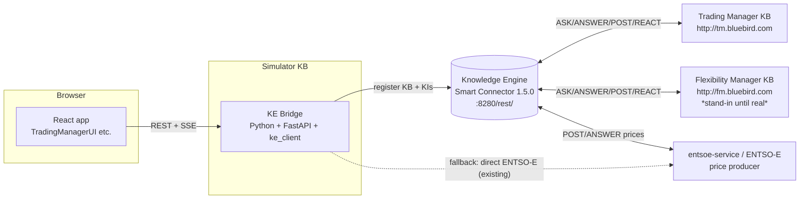

# Implementation Plan — KE Simulator ↔ Knowledge Engine

**Feature:** 001-ke-integration · **Branch:** `develop-edu` · **Planning only**

Derives the **HOW** from [spec.md](spec.md) and [research.md](research.md).
Per-interaction details are in [contracts/](contracts/); execution order is in
[tasks.md](tasks.md). No code is written as part of this document.

---

## 1. Architecture overview

Because `ke_client` is a **Python** library and the simulator runs in the
**browser**, we introduce a thin **KE Bridge** service that is the simulator's
Knowledge Base on the KE. The React app never talks to TM/FM directly — it talks
to the Bridge, and the Bridge talks to everyone else exclusively via the KE.

**Key point:** every solid arrow between KBs goes **through the KE**. The dotted
arrow is the existing ENTSO-E fallback, used only in degraded mode (principle #5).

---

## 2. Components

### 2.1 KE Bridge (new, server-side) — the simulator's KB
- **Tech:** Python ≥3.9, FastAPI + Uvicorn, `ke_client==0.32.3`
  (same pin as TM). Optional `ubflex`/`effi_onto_tools` for shared patterns.
- **Responsibilities:**
  - On startup: `KEClient.build()`, `include()` the simulator's `KIHolder`s,
    `register()` + `start()` the handler loop (background thread).
  - Expose a **small REST API** to the frontend to trigger ASK/POST and read
    results, and an **SSE stream** to push live KE exchange events.
  - Translate frontend requests ⇄ RDF **bindings** (N3) using Pydantic
    `BindingsBase` models; keep all ontology detail here, out of the browser.
  - Implement ANSWER/REACT handlers for interactions where the simulator is a
    producer (e.g. serving its local price cache).
  - **Fallback:** if `register()` fails or a producer is absent, return
    `mode: "simulated"` so the UI can label the run.
- **Config (env, server-side only):** `KE_REST_ENDPOINT`,
  `KE_KNOWLEDGE_BASE_ID`, `KE_KI_CONFIG_PATH`, `KE_VERIFY_SERVER_CERT`,
  `KE_REASONER_LEVEL`. Never exposed to `import.meta.env`.

### 2.2 React frontend (existing) — minimal, swappable changes
- Keep the current **service interfaces** as the seam:
  - [MarketDataService.ts](../../src/services/MarketDataService.ts) —
    `getDayAheadPrices(zone?)`, `getIntradayPrices(zone?)`.
  - [FlexibilityManagerService.ts](../../src/services/FlexibilityManagerService.ts) —
    `getPredictedConsumption()`.
  - [TradingManagerService.ts](../../src/services/TradingManagerService.ts) —
    `runCycle(scenario, zone?)` + `onFlowEvent()`.
- Add a KE-backed implementation of each that calls the Bridge, selected at
  runtime by a flag (`VITE_USE_KE=true`), with the current mock as fallback.
- The Bridge's SSE events feed the existing `onFlowEvent()` timeline so the UI
  code barely changes.

### 2.3 Knowledge Engine (reuse)
- Run the TNO `smart-connector:1.5.0` (reuse TM's `tm-ke-service`, or a dedicated
  SC on the same `tm-net` network). No changes to the KE itself.

### 2.4 Trading Manager (reuse, no changes)
- Consume its published patterns `tm-info`, `tou-price`,
  `tou-price-info-filtered`, `tm-market-offer`.

### 2.5 Flexibility Manager (dependency)
- Real path needs FM to register a KB + KI (out of scope here). Until then, a
  **temporary FM stand-in KB** (a tiny `ke_client` script) answers the agreed
  consumption pattern so the simulator can be developed and demoed.

---

## 3. Per-module connection plan

Full graph patterns and binding shapes are in [contracts/](contracts/). Summary:

### 3.1 Simulator ↔ Trading Manager (via KE)
See [contracts/trading-manager.md](contracts/trading-manager.md).

| Simulator UI stage | KE interaction | Simulator role | Counterpart |
|--------------------|----------------|----------------|-------------|
| `market-service-ask-external` / `*-post-prices` | **ASK** `tou-price` (+ `tou-price-info-filtered` to locate the series) | consumer | TM (price producer) |
| discovery (bootstrap) | **ASK** `tm-info` | consumer | TM |
| `trading-manager-share-offer` | **POST**/observe `tm-market-offer` | producer/consumer | TM |
| `market-day-ahead-cleared` / `market-intraday-cleared` | **ASK**/REACT on market-offer result | consumer | TM |

> **Offer scope (D-Q5):** default is **read-only** — the simulator reads TM
> market/price/clearing info and computes the Share Offer locally. The **write**
> path (POST `tm-market-offer`) is an optional later phase behind a flag.

### 3.2 Simulator ↔ Flexibility Manager (via KE)
See [contracts/flexibility-manager.md](contracts/flexibility-manager.md).

| Simulator UI stage | KE interaction | Simulator role | Counterpart |
|--------------------|----------------|----------------|-------------|
| `trading-manager-ask-fm` | **ASK** `fm-consumption-forecast` | consumer | FM (or stand-in) |
| `flexibility-manager-answer` | **ANSWER** handled by FM | — | FM |

> Pattern naming follows TM's FM-facing conventions
> (`fm-ts-info-request`, `fm-ts`); the exact reuse vs. new-pattern decision is
> fixed in [contracts/flexibility-manager.md](contracts/flexibility-manager.md).
> The FM stand-in is committed (decision **D-Q2**).

### 3.3 Stages that stay local/simulated
The two **Digital Twins** (price-forecast, consumption) and the intraday price
markup have no real counterpart module. They remain **local computations** and
are explicitly labelled "simulated" in the UI (principle #5, FR-5). They can
later be promoted to real KBs if such modules appear.

---

## 4. Data & vocabulary

- Reuse prefixes already used by TM: `rdf`, `saref`, `s4ener`, `time`,
  `ubmarket` (`https://ubflex.bluebird.eu/market/`), `kb` (`${KB_ID}/`).
- Prices: `s4ener:TimeSeries` + `s4ener:DataPoint` with
  `saref:hasTimestamp`, `saref:hasValue`, unit `ubmarket:EURPerMegawattHour`,
  ISP `ubmarket:period_15m`.
- Map the simulator's `PricePoint { startTime, endTime, price }` ⇄ data points,
  and `FlexibilityForecast { predictedConsumptionMWh }` ⇄ an FM consumption
  value. Mapping tables live in the contract files.

---

## 5. Configuration & deployment

- The Bridge joins the existing external Docker network `local_tm-net` so it can
  reach `tm-ke-service:8280`.
- Proposed compose addition (illustrative, not created here):
  - `ke-bridge` (Python/FastAPI) — depends on the KE SC; env `KE_REST_ENDPOINT`,
    `KE_KNOWLEDGE_BASE_ID`, `KE_KI_CONFIG_PATH`.
  - Frontend served as today; `VITE_USE_KE`, `VITE_KE_BRIDGE_URL` point it at the
    Bridge.
- Secrets (if any) stay in the Bridge env; the browser only sees the Bridge URL.

---

## 6. Phasing (high-level; detailed in tasks.md)

1. **Contracts frozen** — agree graph patterns & bindings with TM/FM owners.
2. **KE Bridge skeleton** — register KB, prove `tm-info` ASK round-trips.
3. **Prices via KE** — `tou-price` ASK feeding `MarketDataService` (KE impl).
4. **FM forecast via KE** — against stand-in, then real FM.
5. **Offer/clearing via KE** — `tm-market-offer`.
6. **Frontend wiring + SSE** — live events into the timeline; `VITE_USE_KE`.
7. **Fallback & labelling** — degraded mode parity with mock.
8. **End-to-end demo** — compose on `tm-net`, scripted scenario.

---

## 7. Testing strategy (planning)

- **Contract tests** per interaction: given sample bindings, assert the Bridge
  produces/parses the expected RDF N3 (no live KE needed).
- **Integration tests** against a local `smart-connector:1.5.0` with the TM
  stack + FM stand-in.
- **Fallback tests**: KE down ⇒ UI runs simulated and is labelled as such.
- **UI mapping test**: each of the 13 stages resolves to a declared interaction
  or an explicit "local" tag (traceability for FR-5).

---

## 8. Traceability

| Requirement | Addressed by |
|-------------|--------------|
| FR-1 register KB/KIs | §2.1 Bridge startup |
| FR-2 prices via KE | §3.1, contracts/trading-manager |
| FR-3 FM forecast via KE | §3.2, contracts/flexibility-manager |
| FR-4 offer/clearing via KE | §3.1 `tm-market-offer` |
| FR-5 real stage status | §2.2 SSE + §3.3 labelling |
| FR-6 no direct TM/FM REST | §1 architecture (KE-only) |
| FR-7 fallback | §2.1, §2.2, §7 |
| FR-8 secrets server-side | §2.1, §5 |
| FR-9 reuse TM patterns | §3, §4, research D2 |
